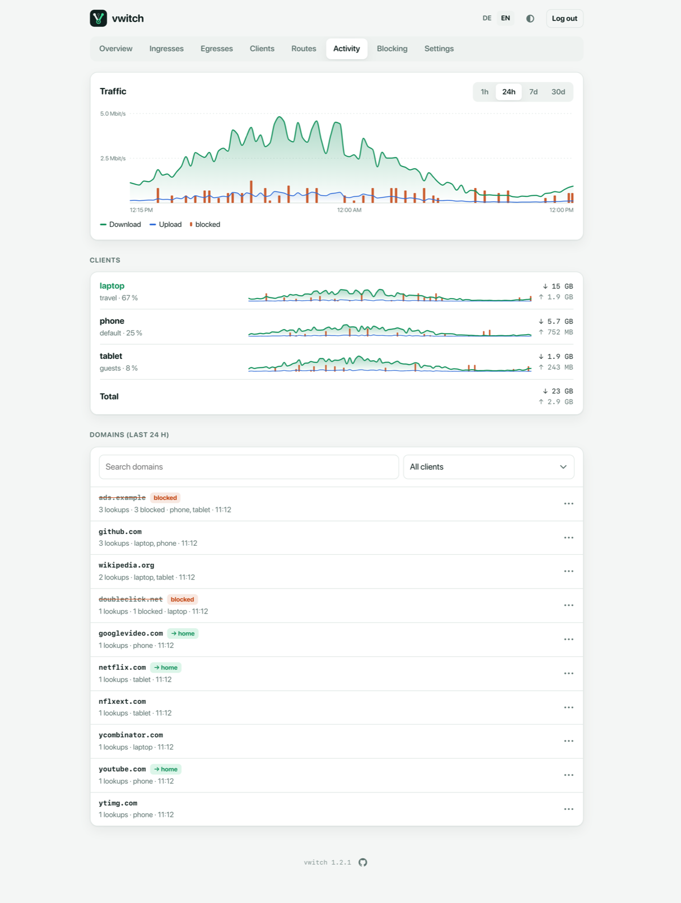
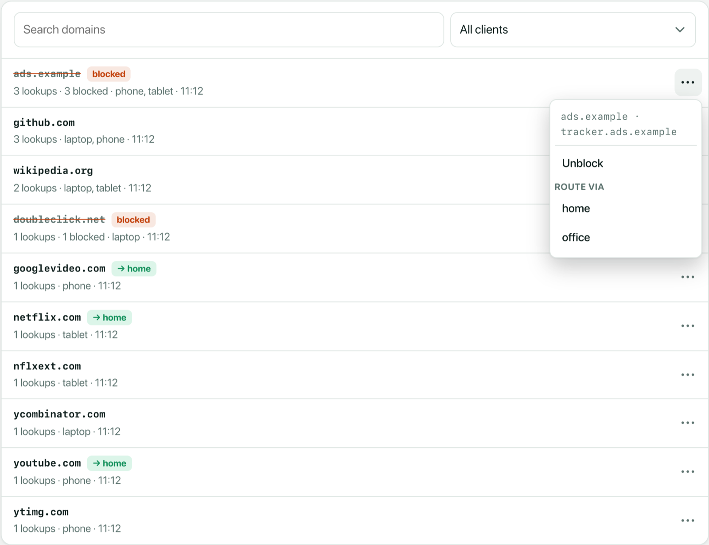

# Activity

The **Activity** page shows how much traffic your clients use and which
websites they look up.



## Traffic

The graph shows download and upload for the last hour, day, week or month.
Red bars along the bottom show blocked lookups and connections (legend
**blocked**); hover a point to see how many, for example *6 blocked*.
vwitch samples the counters every 10 seconds and keeps the history on the
server (`/var/lib/vwitch/traffic.json`), so it survives restarts.

## Clients

Below the graph, every client with its share of the total, a small graph, and
its download and upload for the chosen range. Its small graph shows its own
blocked lookups and outgoing connections as red bars too. Blocked incoming
connections belong to no client and count only toward the total. Click a client to filter the
whole page to it; click it again to show all clients.

## Domains (last 24 h)

The domains clients looked up during the last 24 hours, grouped by site:
`www.youtube.com` and `i.ytimg.com` count for their own sites. Each entry shows
how often it was looked up, by which clients, and when last.

- **blocked** marks domains on the [blocking](blocking.md) list.
- **🇽🇽 country blocked** marks a domain whose address the country filter
  blocked; the tooltip names the country. The lookup worked, but the
  connection to that country did not.
- **→ home** marks domains that a [route](routes.md) sends through an egress.
- Use the search field and the client filter to find something quickly.

The **⋯** menu of an entry acts on it in one step:



- **Block** or **Unblock** the domain for all clients.
- **Route via** an egress: adds the domain to the route that already uses
  this egress, or creates a route named after the egress. A domain in
  another route moves over.

## Privacy

The domain list is kept in memory only, never written to disk, and is gone
after a restart. To switch it off completely, turn off **Domain list** in
[Settings](settings.md), or run:

```sh
vwitch set activity false
```

The traffic graph is not affected.
