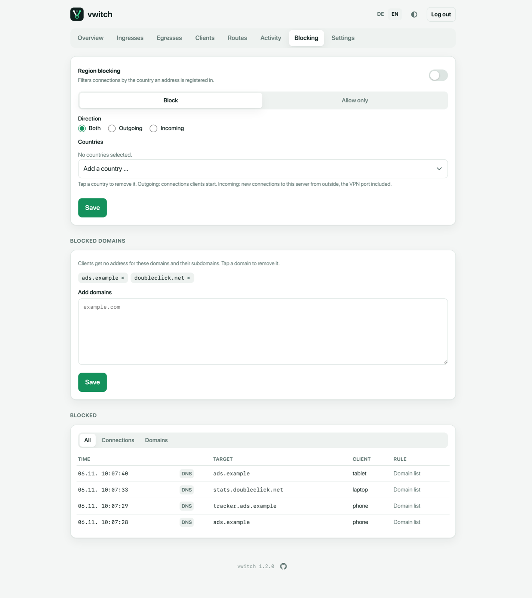

# Blocking

The **Blocking** page blocks domains and whole countries for all clients, and
shows a log of everything that was blocked.



## Blocked domains

Clients get no address for these domains and all their subdomains (vwitch's
DNS answers with `0.0.0.0` or an empty answer). Use it for ads, trackers or
sites that should not be reachable over your VPN.

- Add domains in **Add domains**, one per line, then **Save**.
- Tap a domain chip (`×`) and save to remove it.

Like [domain routes](routes.md), this works through DNS: browsers with their
own encrypted DNS bypass it.

```sh
vwitch block add ads.example tracker.example
vwitch block rm tracker.example
vwitch block list
```

## Region blocking

Region blocking filters connections by the country an address is registered
in.

| Setting | Options |
| --- | --- |
| **Mode** | **Block**: block the selected countries. **Allow only**: block everything except the selected countries. |
| **Direction** | **Outgoing**: connections clients start. **Incoming**: new connections from outside to the server, including the VPN port. **Both**. |
| **Countries** | Pick from the list; tap a country chip to remove it. |

Turn on **Region blocking** and save. vwitch then downloads the address ranges
the regional internet registries publish (about 46 MB, once), keeps a compact
copy on the server and refreshes it weekly. Connections that already exist keep
working. Private and special-purpose address ranges are never filtered.

> **Careful with "Allow only" and incoming connections.** It also locks out
> SSH and the VPN from every other country, including yours when you travel.
> The page shows a warning while this combination is selected.

```sh
vwitch set regions.countries XX,YY        # two-letter country codes
vwitch set regions.mode block             # or: allow
vwitch set regions.direction outgoing     # or: incoming, both
vwitch set regions.enabled true
```

## Blocked log

The log at the bottom shows the latest blocked lookups and connections: time,
type (**DNS**, **↑** outgoing, **↓** incoming), target with country flag,
client and the rule that matched (*Domain list* or *Regions*). Filter with
**All**, **Connections** and **Domains**. The log keeps the last 1000 entries
in memory and refreshes every few seconds.

```sh
vwitch block log
```
