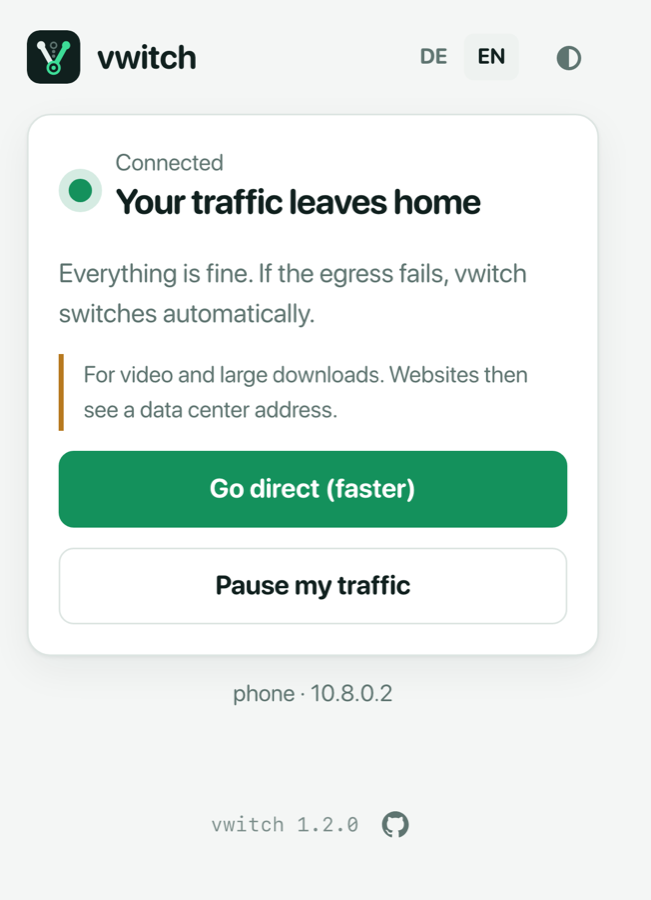
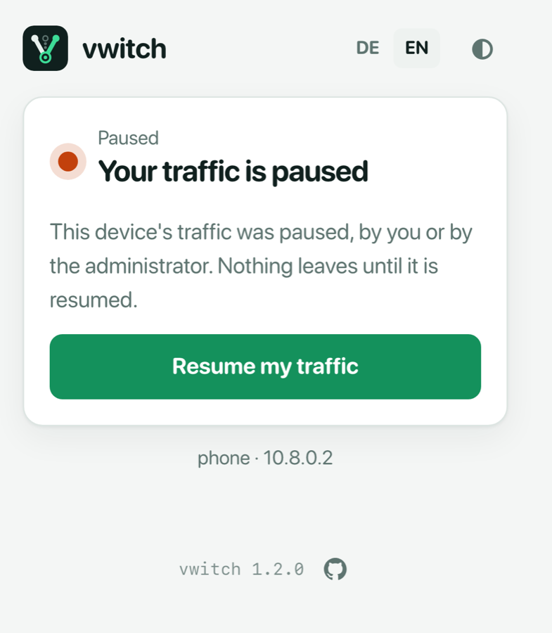
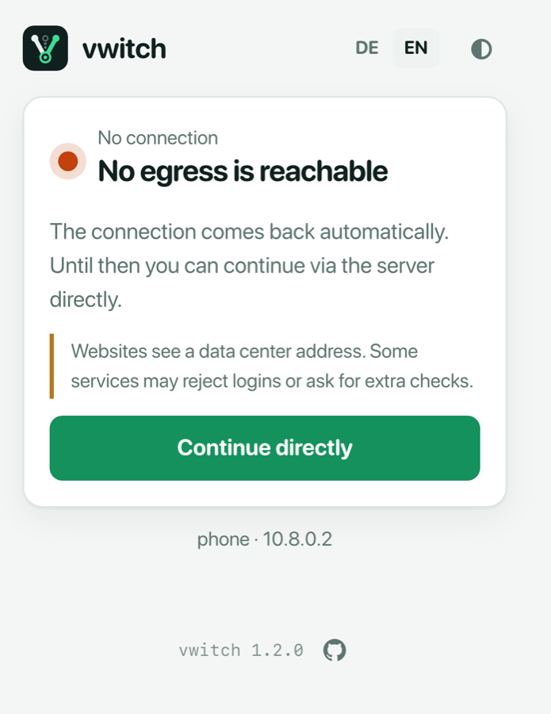

# The client page

Every connected device can open its own small status page at
**http://v.witch** (or another name from *Web address for clients* in the
[settings](settings.md)). It is only reachable through the VPN tunnel and
needs no login: vwitch recognises the device by its tunnel address, which
cannot be faked.

The page is meant for the people using the VPN, not for the administrator.
It is made for phones, and it shows in plain words where the device's traffic
goes and what the person can do about it.

| Everything works | Traffic paused | Outage |
| :---: | :---: | :---: |
|  |  |  |

At the bottom, the page shows the device's name and tunnel address, so people
can tell the administrator which device they are using.

## States

| State | What the page says |
| --- | --- |
| **Connected** | *Your traffic leaves home*. If that egress fails, vwitch switches automatically. |
| **Direct mode** | The device goes straight through the server: faster, but websites see a data center address. |
| **Direct connection** | No egress is available and the device uses the server's own connection until one returns. |
| **No connection** | No egress is reachable. With *Ask the client* (see [Settings](settings.md#egress-selection)), the page offers **Continue directly**. |
| **Paused** | *Your traffic is paused*: the device paused it itself, or the administrator turned on *Block traffic* for it. Nothing leaves until it is resumed. |
| **Blocked** | *No connection right now*: no egress works and the server is set to *Block*. It continues automatically when an egress is back. |
| **Kill switch** | The administrator has stopped all traffic. |

While the state is not *Connected*, the page reloads itself every 20 seconds,
so it shows when the connection is back.

## Buttons

Which buttons appear is set under *What clients may switch on their own page*
in the [settings](settings.md#clients):

| Buttons | When they appear | What they do |
| --- | --- | --- |
| **Go direct (faster)** / **Back via VPN egress** | While connected, if direct mode is allowed. | Sends this device straight through the server, for example for video calls or large downloads. |
| **Continue directly** / **End direct connection** | During an outage, when the server is set to *Ask the client*. | Uses the server's own connection until an egress is back. |
| **Pause my traffic** / **Resume my traffic** | While connected, and while paused (to resume). | A personal kill switch for this device. |

Each device sees and changes only its own state. The admin page
(https://v.witch) is separate and always needs a login.
