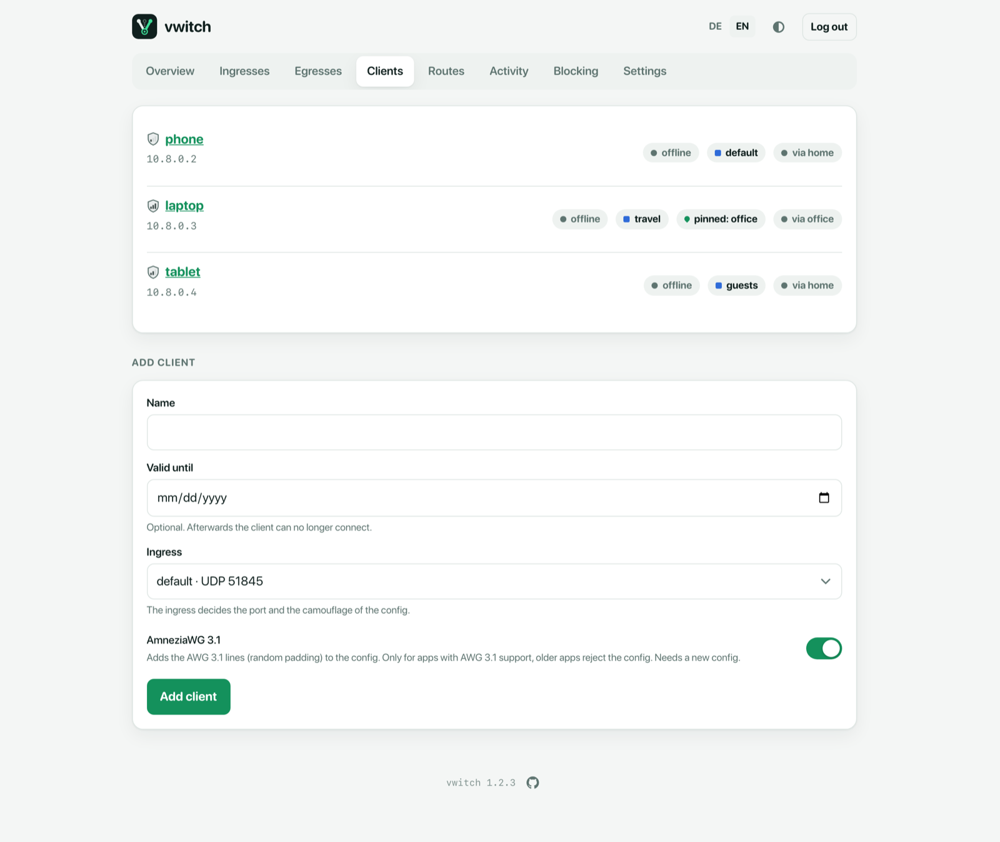
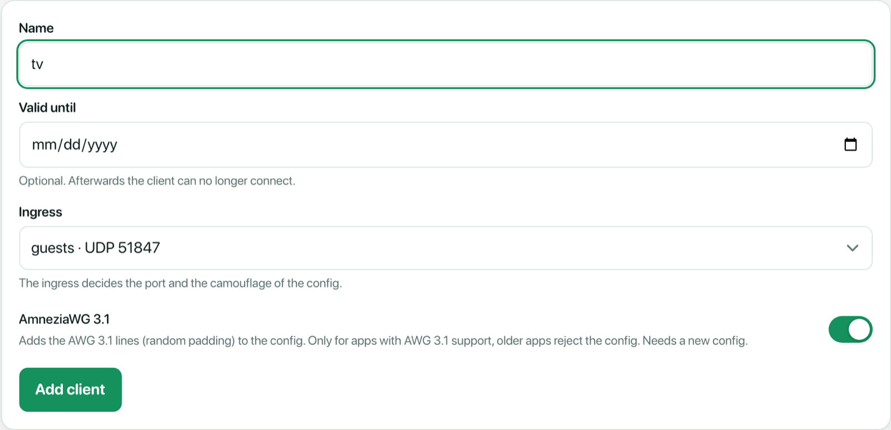
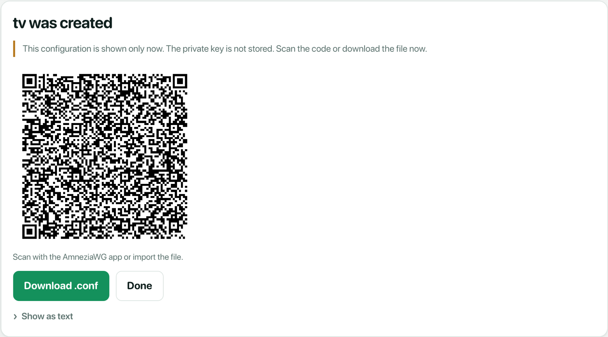
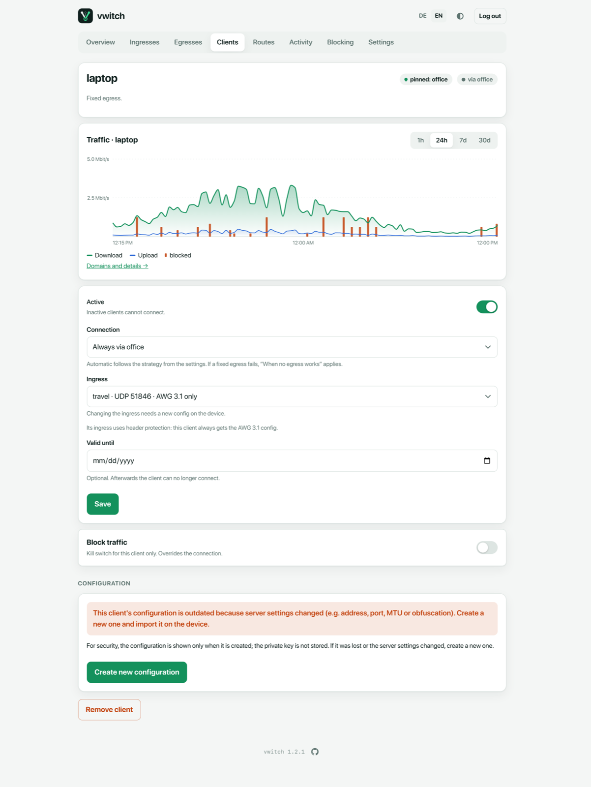

# Clients

A **client** is a device that connects to vwitch: a phone, laptop, tablet or
TV. Each client gets its own config file with its own keys and a fixed
address in the client network (for example `10.8.0.2`).



The list shows every client with its address, expiry date (if set), state
(**online**, **offline** or **inactive**), its ingress (when there is more than
one) and where its traffic currently goes (**via home**, **direct**,
**blocked** or **waiting for decision**).

A client with its own connection choice gets a pill with a small pin:
**pinned: office** means it always uses `office` (if that egress fails, *When
no egress works* applies). A client with its own strategy shows the name of
that strategy instead. Clients without a pin follow the strategy from the
[settings](settings.md).

The small shield before each name shows the client's
[camouflage level](#camouflage-level) with one to three bars. It is coloured
while the client is online and grey otherwise; hover it to see the level.

## Add a client

Under **Add client**:



| Field | Meaning |
| --- | --- |
| **Name** | Letters, digits, `-`, `_` and `.`, for example `phone`. |
| **Valid until** | Optional. After this day the client can no longer connect. Good for guests. |
| **Ingress** | Only shown with more than one [ingress](ingresses.md). Decides the port and camouflage of the config. |
| **AmneziaWG 3.1** | Adds the AWG 3.1 lines to the config. Turn it off for apps without AWG 3.1 support; they reject the config otherwise. |

After **Add client**, vwitch shows the config once, as QR code and file:



Scan the code with the AmneziaVPN app, or download the `.conf` file and import
it. **This is the only time the config is shown.** vwitch keeps only the
client's public key, so nobody can read the config from the server later.

From the command line:

```sh
vwitch client add phone --qr
vwitch client add guest --expires 2026-12-31 --ingress guests --qr
```

## The client page

Click a client to open its page:



- **Top**: where its traffic goes right now and why (for example *First
  working egress in the order*), and its
  [camouflage level](#camouflage-level).
- **Traffic**: its download and upload over time, with its blocked lookups
  and connections as red bars. *Domains and details* opens
  [Activity](activity.md) filtered to this client.
- **Active**: inactive clients cannot connect, but keep their config.
- **Connection**:
  - *Automatic* follows the strategy from the [settings](settings.md).
  - *Always via …* pins the client to one egress. The header then shows
    **pinned: …**.
  - *Direct via the server* sends it through the server's own connection (only
    if direct is allowed).
- **Ingress** and **AmneziaWG 3.1**: see [Ingresses](ingresses.md).
- **Valid until**: change or remove the expiry date.
- **Block traffic**: a kill switch for this client only. It overrides the
  connection choice.

## Camouflage level

Each client has a camouflage level from 1 to 3. It tells you how hard the
client's traffic is to recognise as a VPN for networks that try to block VPNs.
The client page shows it with a large shield, the level name, a short
explanation and a tip for reaching the next level.

| Level | Name | What the client's traffic looks like | How to get there |
| --- | --- | --- | --- |
| 1 | **Basic** | Junk packets before the handshake, padded handshakes and header values of its own. Common WireGuard filters do not recognise it. | Every client has at least this. |
| 2 | **Padding** | Like *Basic*, plus a random length for every data packet, so packet sizes give nothing away. | Turn on **AmneziaWG 3.1** for the client, with **Random padding** on its [ingress](ingresses.md#change-an-ingress). Needs a new config. |
| 3 | **Header protection** | Like *Padding*, plus encrypted headers and random trailers: no fixed byte pattern is left. The strongest level. | Move the client to an *AWG 3.1 only* [ingress](ingresses.md#camouflage), if its app supports it. Needs a new config. |

The level comes from the config vwitch issued to the client, not from
watching its traffic. So:

- If the device still uses an **older config**, the page warns that the shown
  level applies only once the new config is imported.
- If the device is **offline**, the page notes that the level is taken from
  its config.

Scripts find the level in `vwitch status --json` as the field `camouflage`
(1–3) of each client.

## Configuration: lost or outdated

The **Configuration** section explains that the config is not stored. Use
**Create new configuration** when:

- the device lost its config, or
- vwitch shows **This client's configuration is outdated**. This happens after
  a change that affects the config: a new server address, a new port, another
  ingress, or new camouflage settings.

A new configuration gets new keys. The old config stops working immediately.
Import the new one on the device.

```sh
vwitch client renew phone --qr
```

## Remove a client

**Remove client** at the bottom of the client page deletes it. Its config
stops working immediately.

## Command line

```sh
vwitch client list
vwitch client set phone --strategy fixed --fixed office   # always via office
vwitch client set phone --strategy ""                     # back to automatic
vwitch client set tv --expires never
vwitch client switch phone block on                       # block traffic
vwitch client disable tv                                  # enable again with: enable
vwitch client rm tv
```
