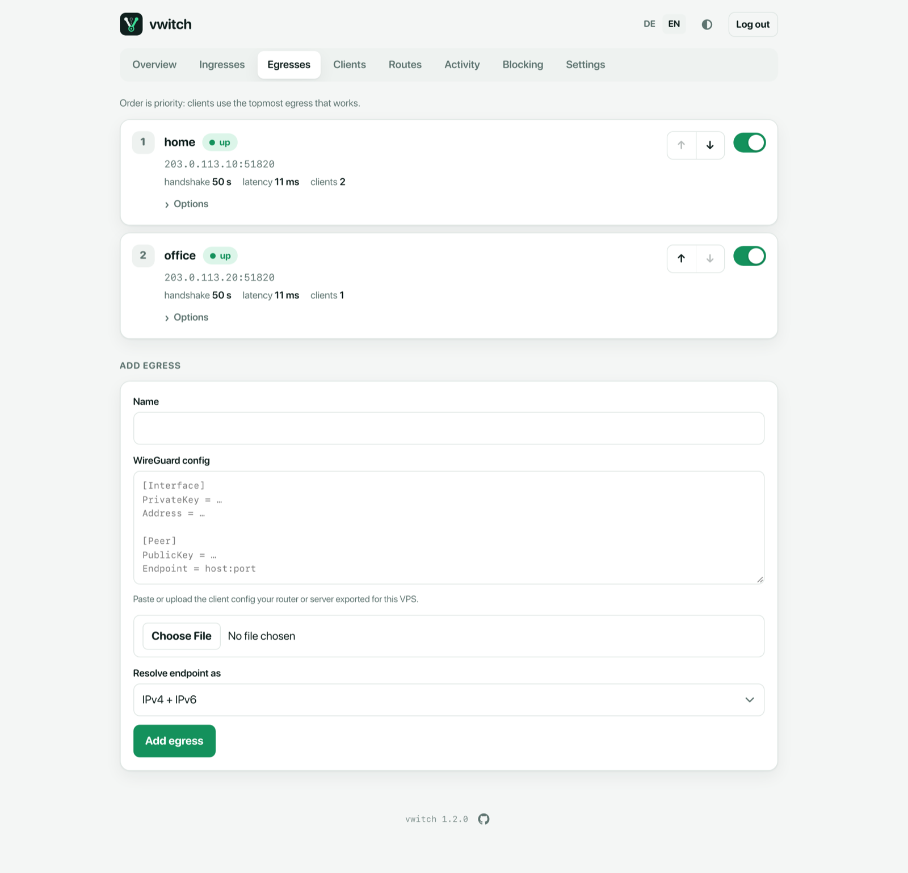
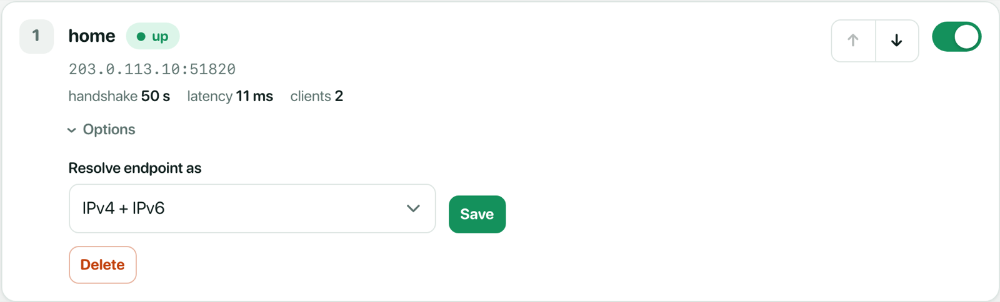

# Egresses

An **egress** is an exit for client traffic. Usually it is a WireGuard tunnel
from your vwitch server to a device you control: a home router with a
WireGuard server, a small Linux box, a company gateway or another server.
Clients then reach what is behind that exit: its local network, the internet
through its connection (websites see the address of that place, not of the
VPS), or both.

vwitch is the WireGuard **client** of each egress. The other side needs no
special software, only a normal WireGuard peer for the VPS.



## Add an egress

1. On the device that should be the exit, create a WireGuard peer for the VPS
   and export its config (`wg-quick` format). It looks like this:

   ```ini
   [Interface]
   PrivateKey = …
   Address = 10.66.1.2/32

   [Peer]
   PublicKey = …
   Endpoint = home.example.org:51820
   AllowedIPs = 0.0.0.0/0
   ```

   `AllowedIPs = 0.0.0.0/0` lets all traffic through the tunnel. What clients
   can reach behind it (only the local network, or the internet as well) is
   decided by the other side's own routing and firewall. The endpoint
   must be reachable from the VPS (port forwarding on a home router).
2. In vwitch, open **Egresses**, scroll to **Add egress**, enter a name and
   paste the config or upload the file.
3. Choose **Resolve endpoint as** (see below) and save.

The egress shows **up** within a few seconds once the tunnel works.

From the command line:

```sh
vwitch egress add home ./home.conf
```

## The egress list

Each egress shows its position, health, endpoint, handshake age, latency and
the number of clients using it.

- **↑ / ↓** change the order. With strategy *failover*, clients use the
  topmost egress that works.
- The **switch** on the right disables an egress without deleting it. Clients
  move to the next one.
- **Options** holds the endpoint resolution, the weight (strategy *weighted*
  only) and **Delete**.



## Resolve endpoint as

| Option | Use it when |
| --- | --- |
| **IPv4 + IPv6** | Default. The hostname has normal records. |
| **IPv4 only** | The other side is only reachable over IPv4. |
| **IPv6 only** | The other side is only reachable over IPv6, for example a home connection without its own public IPv4 address. |

When the other side has a changing address, put a dynamic DNS name into
`Endpoint`. vwitch looks it up again whenever the tunnel stops getting
handshakes.

## How vwitch picks an egress

vwitch checks every egress continuously (handshake age plus a test request
through the tunnel) and switches only after a few failed or successful checks
in a row, so a single lost packet does not cause flapping. How clients are
distributed depends on the strategy in [Settings](settings.md):

| Strategy | Behaviour |
| --- | --- |
| **Failover (by order)** | Everyone uses the first working egress in the list. |
| **Spread (by weight)** | Clients are spread across working egresses by weight (for example 3 to 1). Each client sticks to its egress. |
| **Fixed egress** | Everyone uses one chosen egress. If it fails, *When no egress works* applies. |

Single clients can override the strategy on their [client page](clients.md).
When a client switches egress, vwitch resets its open connections so they
continue on the new path.

## Command line

```sh
vwitch egress list
vwitch egress order home office          # first is preferred
vwitch egress set home --weight 3        # for strategy weighted
vwitch egress set home --resolve ipv6
vwitch egress disable office             # enable again with: enable
vwitch egress rm office
```
