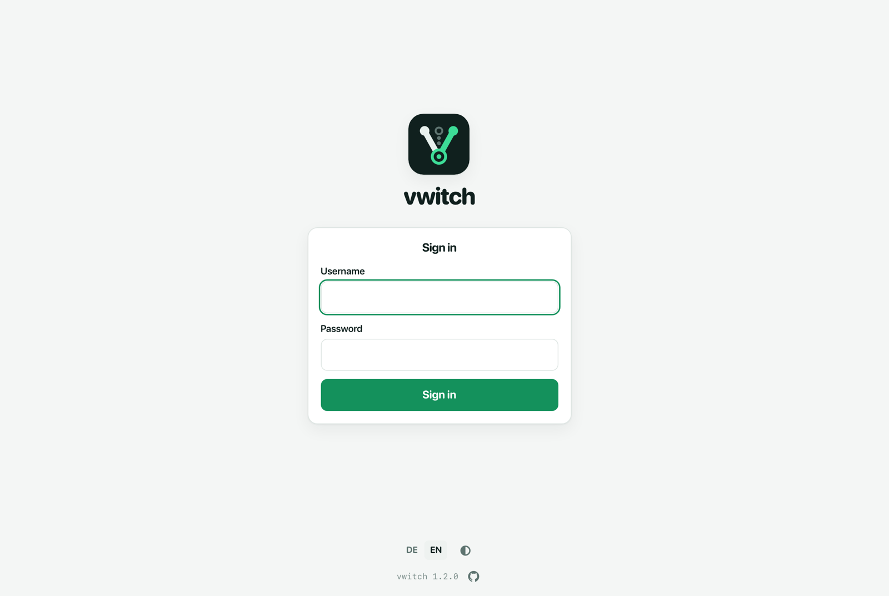
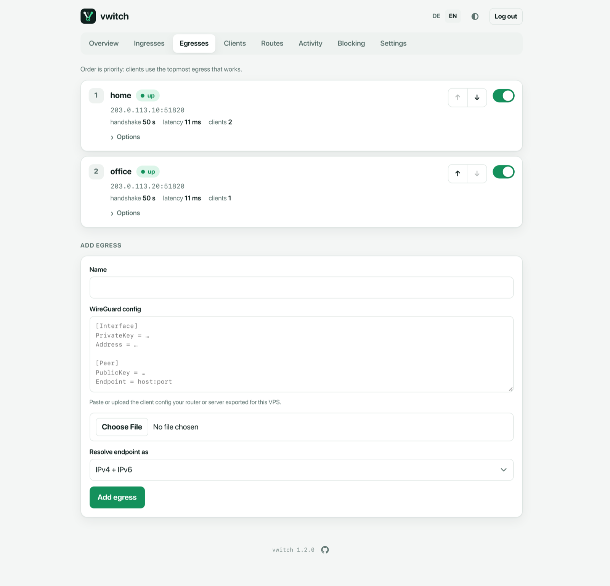
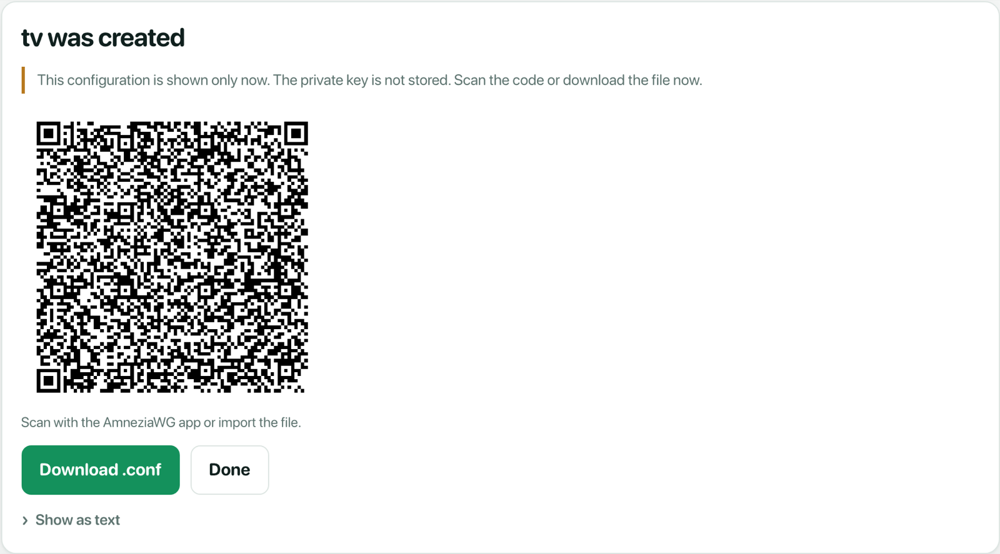
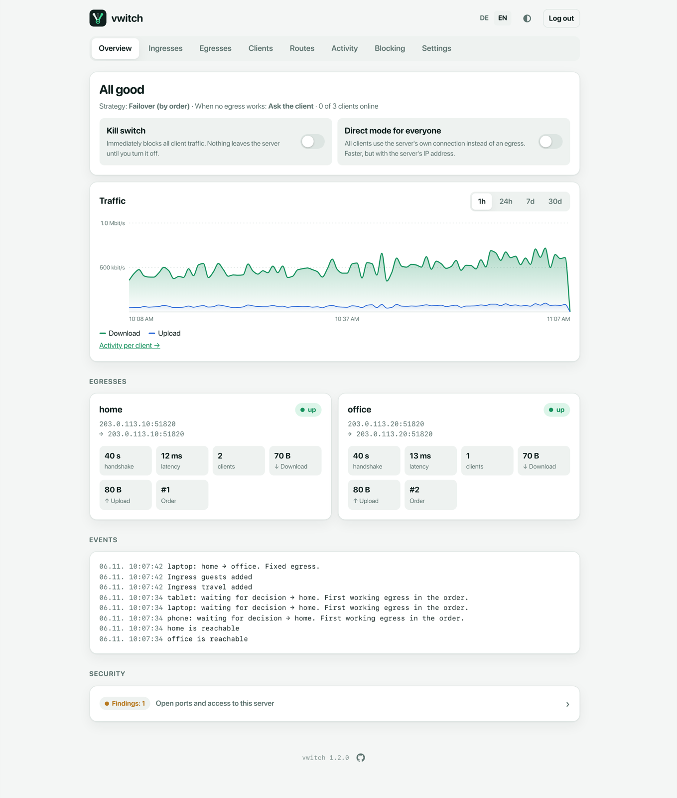

# Getting started

## What vwitch does

vwitch runs on a small rented server (a VPS). Your devices connect to that
server through an encrypted, camouflaged VPN. vwitch then decides **where
their traffic leaves through**: a tunnel to your home, to an office or
another server, or the VPS's own connection. Behind each exit, devices reach
what that place offers: its local network, the internet through it, or both.

Why this helps:

- **Your devices are "at home", even when you travel.** They reach the
  devices in your home or office network. If that exit also provides
  internet access, websites see your home address, not a hotel or mobile
  network.
- **The connection is hard to block.** Devices connect with AmneziaWG, a
  WireGuard variant that disguises its traffic. Networks that block normal VPNs
  usually let it through.
- **It keeps working when one exit fails.** If your home connection goes down,
  vwitch switches to the next exit automatically, and switches back once it
  recovers. If no exit works, it blocks traffic instead of leaking it (you can
  change this).

## The three building blocks

```
  your devices          the VPS (vwitch)                behind each exit
 ┌──────────┐      ┌──────────────────────────┐
 │ phone    │─┐    │                          │──▶ home    ─▶ its network
 │ laptop   │─┼───▶│ ingress ─▶ egress choice │──▶ office  ─▶ its network
 │ tablet   │─┘    │                          │──▶ direct  ─▶ VPS uplink
 └──────────┘      └──────────────────────────┘
   clients                                        egresses
```

| Term | What it is | Example |
| --- | --- | --- |
| **Client** | A device that connects to vwitch. It runs an AmneziaWG app and gets a config file or QR code from vwitch. | `phone`, `laptop`, `tablet` |
| **Ingress** | An entry point on the server: one UDP port with its own camouflage settings. Clients connect to it. A new install has one ingress called `default`. See [Ingresses](ingresses.md). | `default` on UDP 51845 |
| **Egress** | An exit: a WireGuard tunnel from the VPS to a device you control, or the VPS's own connection (*direct*). Clients reach the network behind it, the internet through it, or both. | `home`, `office` |

An egress can be **any standard WireGuard peer**: a home router with a
WireGuard server, a small Linux box at home, a company gateway or another
server. vwitch connects to it as an ordinary WireGuard client, so the other
side needs no special software.

## What you need

- A VPS with a public IPv4 address, running Debian 12+, Ubuntu 22.04+ or
  another systemd Linux on amd64 or arm64. The smallest plan of most providers
  is enough.
- Root access to the VPS (SSH).
- For each egress: a WireGuard config file (`wg-quick` format) that lets the
  VPS connect to that peer. Most routers and gateways with WireGuard can create
  one ("add peer" or "add client", then download the config).
- On each device: an AmneziaWG-capable app, for example the AmneziaVPN app
  (iOS, Android, macOS, Windows, Linux).

## 1. Install

Log in to the VPS and run:

```sh
curl -fsSL https://github.com/sseewald/vwitch/releases/latest/download/install.sh | sudo sh
```

The installer downloads the right package, checks it, generates all keys and
camouflage settings, prints an admin password and starts the service. Note the
password.

Then allow **UDP 51845** in your provider's firewall. This is the only port
vwitch needs from the internet. If you add more [ingresses](ingresses.md),
open their ports too.

Other ways to install (Docker, cloud-init for a fresh VPS) are described in
the [main README](../README.md#install).

## 2. Sign in to the admin UI

The admin UI is not reachable from the internet. Until your first device is
connected, open it through an SSH tunnel from your computer:

```sh
ssh -L 8443:127.0.0.1:443 root@<your-server>
```

Open **https://127.0.0.1:8443** and sign in as `admin` with the password from
step 1. Your browser warns about a self-signed certificate. That is expected:
compare the SHA-256 fingerprint with the one vwitch logs
(`journalctl -u vwitch | grep sha256`) and accept it.



Once a device is connected through vwitch, it can open the admin UI at
**https://v.witch** directly, without the SSH tunnel.

## 3. Add an egress

Open **Egresses**, give the egress a name (for example `home`), paste the
WireGuard config or upload the `.conf` file, and save.



vwitch brings the tunnel up and checks it continuously. An egress is
**up** once a handshake arrived and test traffic gets through. Add more
egresses the same way. Their order is the failover order: vwitch uses the first
healthy one. Use the arrows to change it. Details: [Egresses](egresses.md).

> **Tip:** if the other side has a changing address (dynamic DNS) or is
> reachable only over IPv6, put its hostname into `Endpoint` and choose the
> matching *Resolve endpoint as* option. vwitch looks the name up again
> when the tunnel stops responding.

From the command line:

```sh
vwitch egress add home ./home.conf
```

## 4. Add a client

Open **Clients**, enter a name (for example `phone`) and choose **Add
client**. vwitch shows the config as a QR code and as a file.

Scan the QR code with the AmneziaVPN app, or import the file. **The config is
shown only once**: vwitch keeps only the public key. If you lose it, open the
client and choose *Create new configuration*.



Details: [Clients](clients.md).

From the command line:

```sh
vwitch client add phone --qr
```

Connect the app. The **Overview** now counts the client as online, and
**Clients** shows which egress it uses. Details: [Overview](overview.md).



## 5. Check that it works

On the connected device, open something that is only reachable through the
egress, for example a device in your home network. If the egress also
provides internet access, a "what is my IP" website shows the address of
that place (for example your home connection), not the VPS.

On the server, `vwitch status` shows every egress with its health and every
client with the egress it uses:

```sh
vwitch status
```

## What next

All pages of the admin UI are explained in the [guides](README.md#guides).
Good next steps:

- [Clients](clients.md): pin a device to one exit, set an expiry date for
  guests, or block a device.
- [Ingresses](ingresses.md): separate entry points, for example strict
  camouflage for travel or an isolated one for guests.
- [Routes](routes.md): send certain websites always through your home.
- [Settings](settings.md): choose what happens when no exit works.
- **Hardening**: close all other ports and keep admin access off the
  internet, see [Bulletproof hardening](../README.md#bulletproof-hardening).
