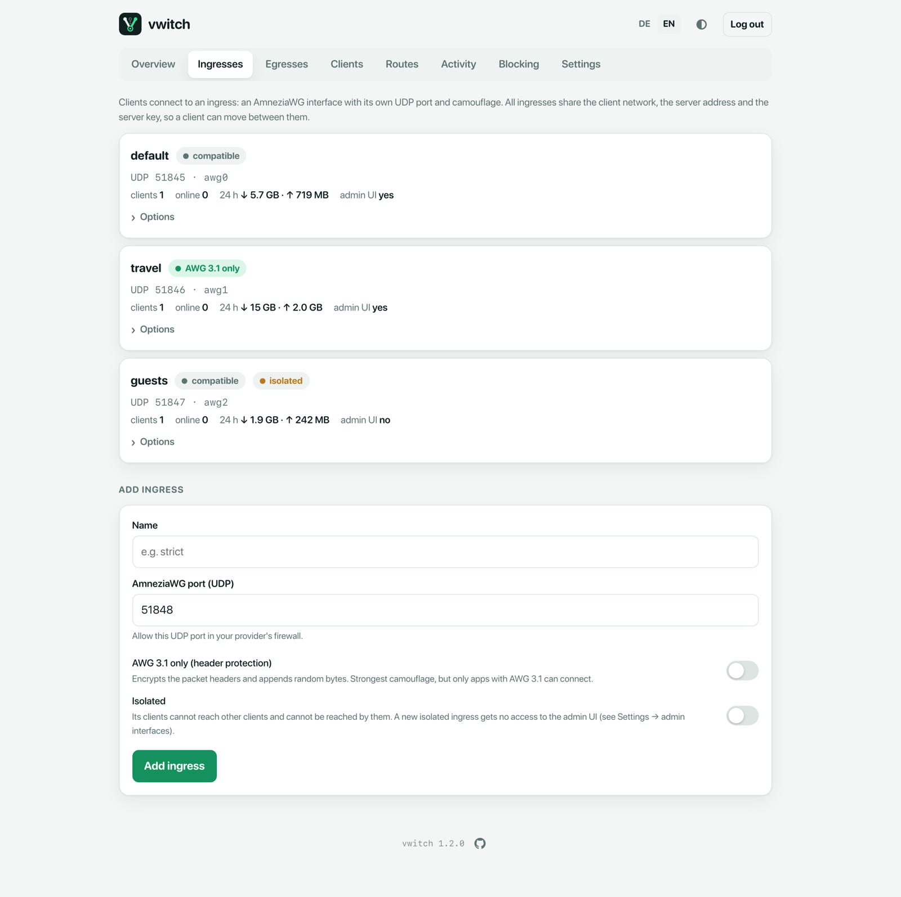
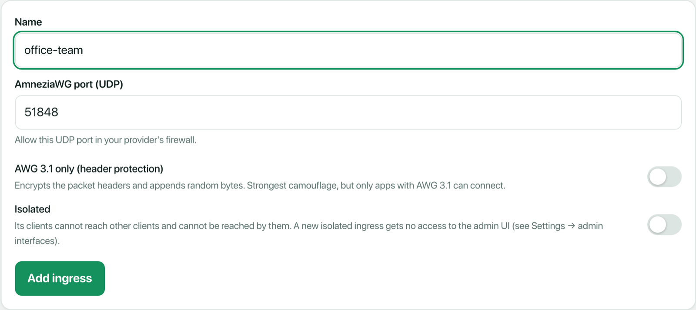
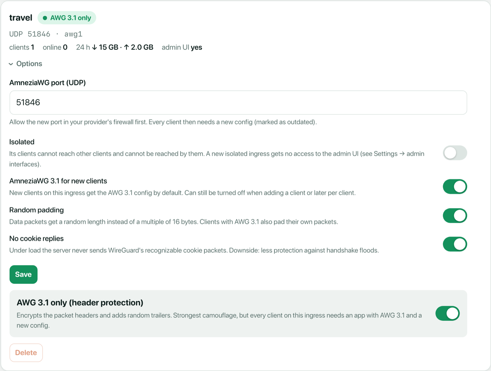
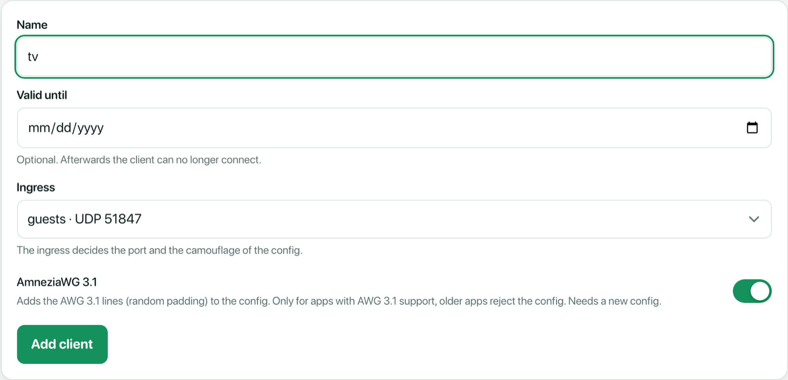
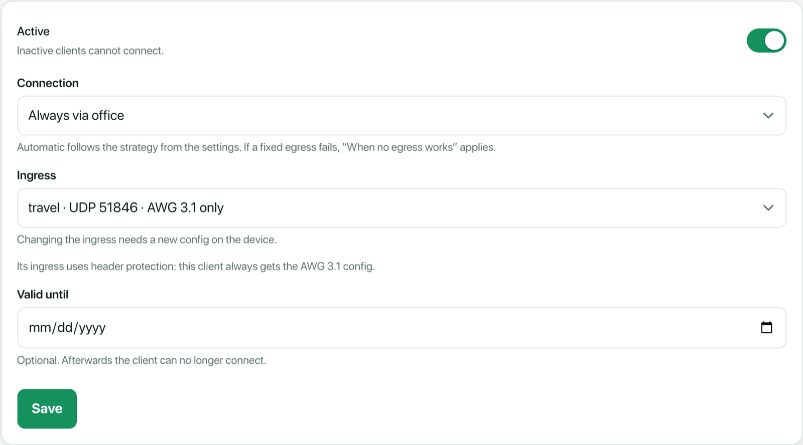

# Ingresses

An **ingress** is an entry point on your vwitch server: one UDP port with its
own AmneziaWG camouflage settings. Every client connects through exactly one
ingress. A new install has a single ingress called `default`, and for many
setups that is all you need.

Add more ingresses when different clients need different rules, for example:

| Ingress | Port | Why |
| --- | --- | --- |
| `default` | 51845 | Your own devices, compatible with every AmneziaWG app. |
| `travel` | 51846 | Strict camouflage for networks that block VPNs aggressively. Needs apps with AmneziaWG 3.1 support. |
| `guests` | 51847 | Devices of friends or visitors: no access to your other devices or the admin UI. |

All ingresses share the same client network, egresses, domain routes,
blocking and kill switch. Only how clients **connect** and what they may
**reach on the VPN** differ.



## What each ingress shows

- **Name** and the mode badges: *compatible* or *AWG 3.1 only*, and
  *isolated* if set.
- **UDP port and interface.** The first ingress uses `awg0`, the next ones
  `awg1`, `awg2` and so on.
- **Clients** assigned to it and how many are **online** right now.
- **24 h**: download and upload of its clients during the last 24 hours.
- **admin UI**: whether its clients can open the admin UI at https://v.witch.

## Add an ingress

Open **Ingresses** in the admin UI and fill in the form at the bottom:



1. **Name**: letters, digits, `-`, `_` and `.`, for example `guests`.
2. **AmneziaWG port (UDP)**: the UDP port clients connect to. vwitch suggests the next free
   one after the highest port in use.
3. **AWG 3.1 only (header protection)** (optional): see
   [Camouflage](#camouflage) below.
4. **Isolated** (optional): see [Isolation](#isolation) below.

vwitch generates fresh, random camouflage parameters for every new ingress,
creates its interface and starts listening right away.

> **Open the port.** Allow the new UDP port in your provider's firewall, or
> clients cannot reach it. The **Security** panel on the overview does not
> list ingress ports as a problem, because vwitch owns them.

## Change an ingress

Expand **Options** on an ingress to change it:



| Option | What it does | Clients need a new config? |
| --- | --- | --- |
| **AmneziaWG port (UDP)** | The UDP port of this ingress. | Yes |
| **Isolated** | See [Isolation](#isolation). | No |
| **AmneziaWG 3.1 for new clients** | New clients of this ingress get configs with the AmneziaWG 3.1 lines. Turn it off if most of its clients use apps without AWG 3.1 support. You can still choose per client. | No (only affects new clients) |
| **Random padding** | Data packets get a random length instead of a multiple of 16 bytes. The padding sits inside the encryption. Clients with AWG 3.1 pad their own packets too. Works with every client. | No |
| **No cookie replies** | Under load the server never sends WireGuard's recognisable cookie packets. Works with every client. Downside: less protection against handshake floods. | No |
| **AWG 3.1 only (header protection)** | See [Camouflage](#camouflage). | Yes |

When a change needs new configs, vwitch marks the affected clients as
**outdated** on the **Clients** page. Open each one and choose *Create new
configuration*, or run `vwitch client renew <name>`, then import the new
config on the device.

## Camouflage

Every ingress has its own set of AmneziaWG parameters (junk packets, header
values, padding sizes). Two ingresses therefore look different on the wire,
and a client config always belongs to one ingress. All ingresses share the
client network, the server address and the server key, so a client keeps its
address when it moves; it only needs a new config.

- **Compatible** (the default) works with every AmneziaWG app.
- **AWG 3.1 only** (strict) encrypts the packet headers and appends random
  bytes. It is the strongest camouflage, but **every client of this ingress must support AmneziaWG
  3.1**. Turning strict mode on or off changes the server parameters, so all
  clients of that ingress need new configs. Other ingresses are not affected.

A good pattern is to keep `default` compatible and add a separate *AWG 3.1 only*
ingress, then move only the devices that support AWG 3.1 to it.

## Isolation

Clients of an **isolated** ingress can use:

- their egress, through the normal egress selection,
- vwitch's DNS and the client page (http://v.witch inside the tunnel).

They **cannot** reach clients of any other ingress, and no other client can
reach them. Clients of non-isolated ingresses can still reach each other
across ingresses.

Admin access is decided when the ingress is created: a non-isolated ingress
is added to the admin interfaces, an isolated one is not. To change this
later, edit **Admin interfaces** under **Settings** (for example add or
remove `awg2`).

## Assign clients to an ingress

As soon as there is more than one ingress, the **Add client** form asks which
ingress the new client uses. The *AmneziaWG 3.1* switch follows that
ingress's setting, and is hidden for *AWG 3.1 only* ingresses, which always need it.



To move an existing client, open it on the **Clients** page and pick another
ingress:



Moving changes the port and camouflage the client must use, so it needs a new
config afterwards. Until the device imports it, it cannot connect.

## Remove an ingress

Expand **Options** and choose **Delete**. This works only when no client uses
the ingress: move or remove its clients first. The last remaining ingress
cannot be removed. Close its port in your provider's firewall afterwards.

## From the command line

Everything above also works with `vwitch ingress` on the server:

```sh
vwitch ingress list                              # name, interface, port, mode, clients
vwitch ingress add travel --strict               # next free port, AWG 3.1 only
vwitch ingress add guests --port 51847 --isolated
vwitch ingress set travel --port 51850           # clients need new configs
vwitch ingress set default --cookies=false       # no cookie replies
vwitch ingress rm guests                         # only without clients
```

| Flag | Meaning |
| --- | --- |
| `--port` | UDP port. Default for `add`: the next free port. |
| `--strict` | AWG 3.1 only (header protection). |
| `--isolated` | Keep its clients apart from all other clients. |
| `--padding` | Random padding of data packets. |
| `--cookies` | Send cookie replies under load. `--cookies=false` turns them off. |
| `--new-clients-awg3` | New clients get the AWG 3.1 config by default. |

With `set`, only the flags you pass change. To choose or change a client's
ingress:

```sh
vwitch client add tv --ingress guests --qr
vwitch client set laptop --ingress travel        # then: vwitch client renew laptop
```

## In the config file

Ingresses live in `/etc/vwitch/vwitch.yaml` like everything else. The admin UI
writes this file for you, so you rarely need to edit it. A trimmed example
(the `awg` blocks hold generated values and are shortened here):

```yaml
ingresses:
  - name: default
    interface: awg0
    listen_port: 51845
    awg: { ... }
  - name: travel
    interface: awg1
    listen_port: 51846
    awg: { ... }        # strict: includes a header protection key
  - name: guests
    interface: awg2
    listen_port: 51847
    isolated: true
    awg: { ... }

clients:
  - name: laptop
    ingress: travel
    # ...
```

Configs from versions before ingresses existed are converted automatically on
the first start: the old single ingress becomes `default`, with the same port
and parameters, so existing clients keep working.
