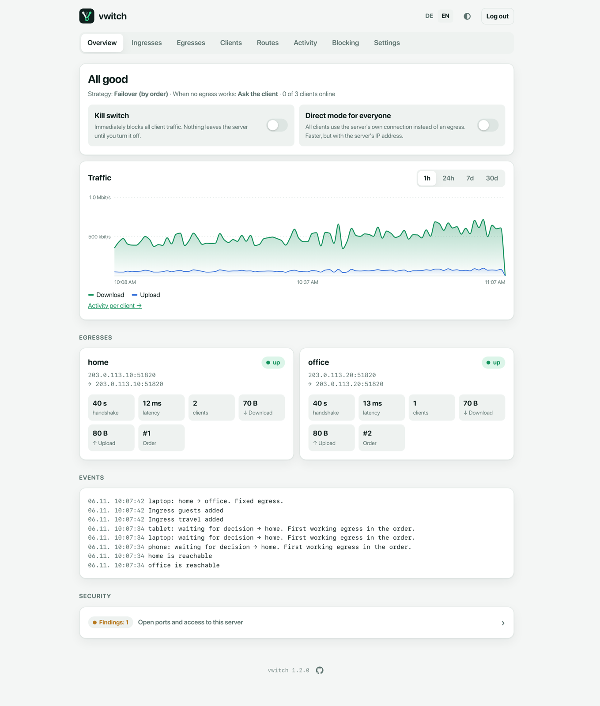
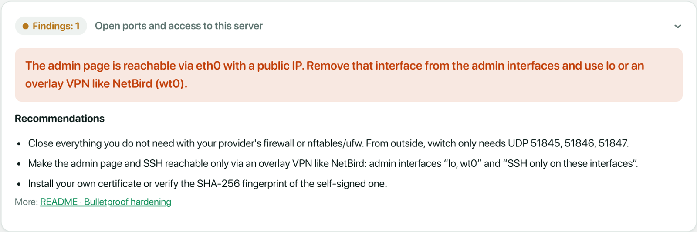

# Overview

The **Overview** is the start page of the admin UI. It answers one question at
a glance: is everything working, and where does traffic go?

## Status and main switches

The top card shows the overall state:

- **All good**: vwitch runs normally.
- **Kill switch is on** or **Direct mode is on** when one of the switches below
  is active.

Below the title: the selection **strategy**, what happens **when no egress
works**, and how many clients are online. Both are set under
[Settings](settings.md).

| Switch | What it does |
| --- | --- |
| **Kill switch** | Immediately blocks all client traffic. Nothing leaves the server until you turn it off. Use it when you suspect a problem and want everything to stop. |
| **Direct mode for everyone** | All clients use the server's own connection instead of an egress. Faster, but websites see the server's address. Shown only if direct is allowed in the settings. |

From the command line: `vwitch killswitch on|off` and `vwitch fast on|off`.

## Traffic

Download and upload of all clients together, for the last hour, day, week or
month. **Activity per client** opens the [Activity](activity.md) page.

## Egresses

One card per egress, in failover order:

| Field | Meaning |
| --- | --- |
| **up / down / disabled** | Health. *Up* means a recent handshake and a successful test request through the tunnel. |
| Endpoint | The address of the other side, and (after `→`) the address it currently resolves to. |
| **handshake** | Time since the last WireGuard handshake. |
| **latency** | Round trip of the last test request through the tunnel. |
| **clients** | Clients that currently use this egress. |
| **Download / Upload** | Current rate through this egress. |
| **Order** | Position in the failover order (with the weight for strategy *weighted*). |

If an egress is down, the card shows the last error underneath.

## Events

The latest events, newest first: egresses going up or down, clients switching
egress (with the reason), clients and ingresses added or removed, switches
turned on or off. The page updates live; no reload needed.

## Security

The **Security** panel checks the server and lists what should not be reachable
from the internet: open ports of other services, SSH reachable from
everywhere, or the admin page on an interface with a public address. Click it
for details and recommendations.

The example shows a typical finding: the admin page is allowed on `eth0`, the
public interface. The fix is to remove `eth0` from the admin interfaces in
[Settings](settings.md). The ports of vwitch's own ingresses are never listed
as findings. See also
[Bulletproof hardening](../README.md#bulletproof-hardening).
