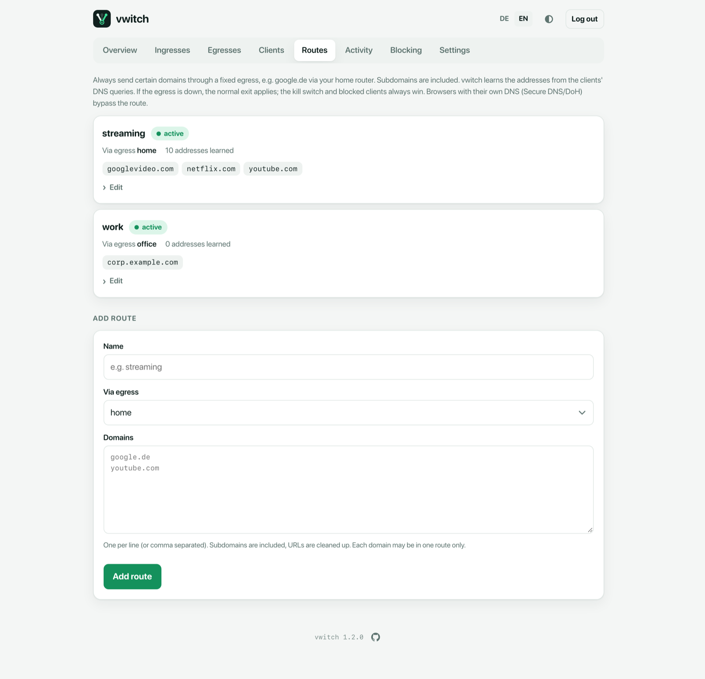

# Domain routes

A **route** sends certain domains always through one egress, no matter which
exit the client normally uses. Typical uses:

- a streaming service that should always see your home connection,
- a company website that only accepts the office address,
- a bank that blocks logins from abroad.



Each route shows its egress, whether it is **active**, how many addresses vwitch
has learned for it, and its domains. **Edit** changes the egress or the
domains, or deletes the route.

## Add a route

Under **Add route**:

1. **Name**: for example `streaming`.
2. **Via egress**: the egress these domains should always use.
3. **Domains**: one per line or comma separated. Subdomains are included, so
   `netflix.com` also covers `www.netflix.com`. Pasted URLs are cleaned up:
   `https://www.Example.com/page` becomes `www.example.com`.

Each domain may belong to one route only. If routes overlap, the most specific
domain wins: `mail.example.com` can use another egress than `example.com`.

## How it works

Clients use vwitch as their DNS server. When a client looks up a routed
domain:

1. vwitch sends the lookup itself through the route's egress, so services with
   many locations answer with addresses that fit that path.
2. vwitch adds a rule for the returned addresses **before** it answers the
   client, so the very first connection already takes the route.
3. Learned addresses are kept for at least an hour, so long downloads or
   video calls stay on their path.

Rules that always win over a route:

- The **kill switch** and a client's **Block traffic** switch.
- If the route's egress is **down**, the route shows *Egress down – normal
  exit*, and clients use their normal exit until it is back.

## Limits

- Browsers with their own encrypted DNS (*Secure DNS* or *DNS over HTTPS*)
  and apps with hard-coded addresses bypass vwitch's DNS, and therefore the
  route.
- Addresses a device cached before you created the route apply once its DNS
  entry expires (usually minutes).

Domains can also be routed in one step from the [Activity](activity.md) page.

## Command line

```sh
vwitch route set streaming --via home netflix.com youtube.com
vwitch route add streaming example-video.com
vwitch route rm streaming youtube.com     # remove one domain
vwitch route rm streaming                 # remove the route
vwitch route list
```
