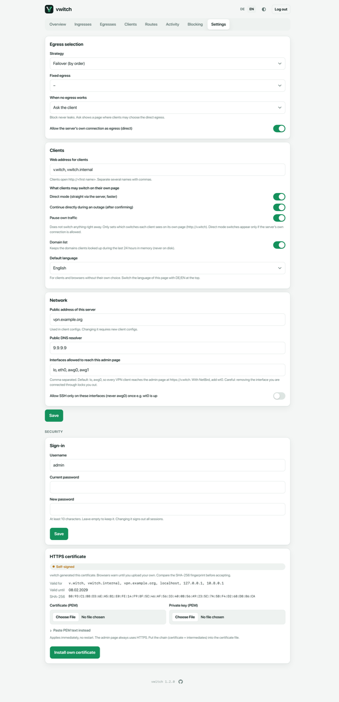

# Settings

The **Settings** page holds everything that applies to the whole server.
Changes are written to `/etc/vwitch/vwitch.yaml` and take effect right after
**Save**; no restart needed. If you leave the page with unsaved changes,
vwitch asks first.



Every setting can also be changed with `vwitch set <key> <value>`; the key is
given in the tables.

## Egress selection

| Setting | Meaning | Key |
| --- | --- | --- |
| **Strategy** | *Failover (by order)*, *Spread (by weight)* or *Fixed egress*. See [Egresses](egresses.md#how-vwitch-picks-an-egress). | `strategy` |
| **Fixed egress** | The egress for strategy *Fixed egress*. | `fixed` |
| **When no egress works** | See below. | `offline` |
| **Allow the server's own connection as egress (direct)** | Needed for direct mode, per-client *Direct via the server* and the *Direct* fallback. | `allow_direct` |

**When no egress works:**

- **Block (nothing leaves)**: the default and the safest choice. Clients have
  no connection until an egress is back. Nothing leaks.
- **Ask the client**: clients see a page (`http://v.witch`) where they can
  choose to continue through the server directly. DNS keeps working so the
  page can load.
- **Direct via the server**: clients continue through the server's own
  connection automatically.

In every case vwitch returns to an egress by itself as soon as one recovers.

## Clients

| Setting | Meaning | Key |
| --- | --- | --- |
| **Web address for clients** | The names clients use for vwitch inside the tunnel, for example `v.witch`. The first one is shown to clients. | `hostnames` |
| **What clients may switch on their own page** | Which buttons each client sees on its [client page](client-page.md): *direct mode*, *continue directly during an outage*, *pause own traffic*. This does not switch anything by itself. | `portal_actions` |
| **Domain list** | Keep the looked-up domains of the last 24 hours in memory for the [Activity](activity.md) page. | `activity` |
| **Default language** | English or German, for clients and browsers without their own choice. Switch the language of the admin page with **DE / EN** at the top. | `language` |

## Network

| Setting | Meaning | Key |
| --- | --- | --- |
| **Public address of this server** | Hostname or IP that goes into client configs. Changing it makes all client configs outdated. | `endpoint` |
| **Public DNS resolver** | Where vwitch forwards client DNS lookups, through each client's own egress. Default `9.9.9.9`. | `resolver` |
| **Interfaces allowed to reach this admin page** | Default `lo, awg0`: the server itself and every VPN client of the first ingress. With an overlay VPN such as NetBird, add `wt0`. Removing the interface you are connected through locks you out. | `admin_interfaces` |
| **Allow SSH only on these interfaces** | Once the overlay interface (for example `wt0`) is up, SSH is only accepted on the admin interfaces. SSH is never opened to VPN clients. | `lockdown_ssh` |

The ports of the ingresses are set on the [Ingresses](ingresses.md) page.

## Sign-in

Change the admin **username** and **password**. Every change needs the
**current password**. A new password needs at least 10 characters and signs
out all other sessions.

Forgot the password? On the server:

```sh
vwitch admin passwd
```

## HTTPS certificate

The admin page is HTTPS only. Without your own certificate, vwitch uses a
**self-signed** one, renews it automatically and shows its names, expiry date
and **SHA-256** fingerprint here. Compare that fingerprint with the browser's
before accepting the warning.

To use your own certificate, upload the certificate (with the intermediate
chain) and the private key as files, or paste them as PEM text, then
**Install own certificate**. It applies immediately. **Remove own
certificate** goes back to the self-signed one.

```sh
vwitch tls set cert.pem key.pem
```
